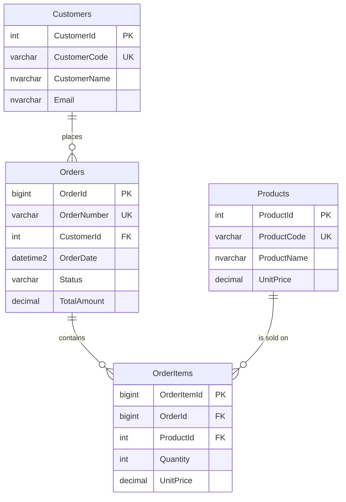

# SQL Server CPU Optimization

Five mistakes that raise SQL Server CPU, each with a runnable before script, a runnable after script, and the plan shape to expect. The database is a fictional order-management system: customers, products, orders, and order lines. There is no application layer. The queries are the product.

The target platform is **SQL Server 2022 or later, compatibility level 160**. Every script also runs on **SQL Server 2019, compatibility level 150**. Nothing in the workload uses 2022-only syntax. `00_CreateDatabase.sql` sets level 160 when the instance is SQL Server 2022 or later, and level 150 on SQL Server 2019 because that is the highest level that instance can store. Scalar UDF inlining, which scenario 04 has to reason about, requires level 150 or higher.

## The five mistakes

| # | Mistake | What consumes CPU | Fix in `After.sql` |
| --- | --- | --- | --- |
| 01 | Non-sargable predicate | `YEAR` / `MONTH` on `OrderDate`, so the date index is scanned and the expression runs per row | Half-open range on the bare column, which seeks `IX_Orders_OrderDate` |
| 02 | Implicit conversion | `nvarchar` compared with a `varchar` code, so every key is converted and the unique index is scanned | Parameter declared as `varchar`, matching the column |
| 03 | Sort the engine has to invent | Top N Sort over all 320,000 shipped orders | Index on `(Status, TotalAmount DESC, OrderId DESC)` so the seek returns 100 rows already ordered |
| 04 | Scalar UDF per line | 80,000 calls, serial plan. The function is excluded from inlining | The same arithmetic inline, plus an inline TVF if it must be reused |
| 05 | Rows the question does not need | Totals for all 1,600,000 lines, then a filter that keeps 600 orders | Filter the orders first, then aggregate about 2,400 lines |

Each scenario folder has `Explanation.md` with the plan operators, how to read CPU time, elapsed time, and logical reads, and the cases where the rewrite does not help.

## Quick start in SSMS

You need:

* SQL Server 2019 or later. SQL Server 2022 is the intended version. SQL Server 2019 runs the same scripts at compatibility level 150.
* SQL Server Management Studio.
* A login that can create a database (`sysadmin` or `dbcreator`). Windows authentication to a local Developer Edition instance is enough.
* A development instance. The first script drops a database named `SqlServerCpuOptimization` if that name already exists.

Setup, in this order. For each file, use **File → Open → File**, then **Execute** (F5). Watch the **Messages** tab.

1. `database/00_CreateDatabase.sql`
2. `database/01_CreateTables.sql`
3. `database/02_CreateIndexes.sql`
4. `database/03_SeedData.sql` (often a minute or two)
5. `database/04_VerifyData.sql`

Stop if step 5 throws. Success ends with `Verification passed.` The database list in Object Explorer should contain `SqlServerCpuOptimization`. Later scripts switch to it themselves.

Run the scenarios one pair at a time. Open the `Before.sql`, press F5, then open the matching `After.sql` and press F5. Read that folder's `Explanation.md` next to the plan.

| Scenario | Before | After |
| --- | --- | --- |
| 01 Non-sargable predicates | `scenarios/01_NonSargablePredicates/Before.sql` | `scenarios/01_NonSargablePredicates/After.sql` |
| 02 Implicit conversions | `scenarios/02_ImplicitConversions/Before.sql` | `scenarios/02_ImplicitConversions/After.sql` |
| 03 Unnecessary sorting | `scenarios/03_UnnecessarySorting/Before.sql` | `scenarios/03_UnnecessarySorting/After.sql` |
| 04 Scalar functions | `scenarios/04_ScalarFunctions/Before.sql` | `scenarios/04_ScalarFunctions/After.sql` |
| 05 Excessive row processing | `scenarios/05_ExcessiveRowProcessing/Before.sql` | `scenarios/05_ExcessiveRowProcessing/After.sql` |

**Query → Include Actual Execution Plan** (Ctrl+M) shows operators. Turn it off when you want timings. Capturing the plan changes elapsed time. In Messages, record the block `SQL Server Execution Times` (CPU time and elapsed time), not `parse and compile time`. Logical reads are on the `SET STATISTICS IO` line for `Orders`, `OrderItems`, or `Customers`. Run a timing script a second time and keep that execution; the first can include compile time and reads from disk.

These scenario scripts send rows to the results grid, so their elapsed time includes SSMS drawing the grid. For a comparison that does not, run `benchmarks/RunBefore.sql` and then `benchmarks/RunAfter.sql` with the actual plan turned off. Those scripts need the database created above. They do not run against a database that setup only dropped.

The same five files can be run with `sqlcmd` instead of SSMS:

```text
sqlcmd -S localhost -E -i database\00_CreateDatabase.sql
sqlcmd -S localhost -E -i database\01_CreateTables.sql
sqlcmd -S localhost -E -i database\02_CreateIndexes.sql
sqlcmd -S localhost -E -i database\03_SeedData.sql
sqlcmd -S localhost -E -i database\04_VerifyData.sql
```

## Safety

`database/00_CreateDatabase.sql` **drops and recreates** a database named `SqlServerCpuOptimization`. Run it on a development instance. Do not run it where that name is already a real database.

Do not run `DBCC DROPCLEANBUFFERS` or `DBCC FREEPROCCACHE` from these scripts. They are not included. Both affect every database on the instance.

Query Store is off after setup. Timed comparisons in `benchmarks/` assume it stays off on both sides, or on for both sides. `diagnostics/05_QueryStore.sql` turns it on and says so at the top of the file.

## Permissions

| Action | Permission |
| --- | --- |
| `00_CreateDatabase.sql` | `CREATE DATABASE` (`sysadmin` or `dbcreator`) |
| Schema, seed, verify, scenario scripts, index in scenario 03 | `db_owner` on `SqlServerCpuOptimization` |
| `SET STATISTICS IO` / `SET STATISTICS TIME` | Permission to run the query |
| Actual execution plan | `SHOWPLAN` in the database (`db_owner` includes this) |
| `diagnostics/03` and `diagnostics/04` | `VIEW DATABASE STATE` (`db_owner` includes this) |
| `diagnostics/02` (plan cache) | `VIEW SERVER STATE`, or `VIEW SERVER PERFORMANCE STATE` on SQL Server 2022+ |
| `diagnostics/05` | `ALTER` on the database and `VIEW DATABASE STATE` |

`dbo.fn_LineAmountWithTax` is created `WITH INLINE = OFF` and reads no tables. Creating it requires permission to create a function in `dbo`, which `db_owner` has.

## Data

All names are synthetic. Email addresses use the reserved `example.test` domain. The seed is set-based and deterministic. On a workstation it often takes a few minutes. Indexes are rebuilt at the end so later logical reads are not page splits left behind by the insert. Recovery is `SIMPLE` because this is a disposable demo database, not a production recommendation. `AUTO_CLOSE` is turned off so a benchmark does not pay for reopening the database; Express otherwise defaults new databases to auto-close. `00_CreateDatabase.sql` starts in `master`, drops any existing `SqlServerCpuOptimization`, and creates it again. It does not leave the name dropped.

| Table | Rows | Keys and rules |
| --- | --- | --- |
| `dbo.Customers` | 80,000 | `CustomerId` int identity. `CustomerCode` `varchar(16)`, `C` + 8 digits. |
| `dbo.Products` | 4,000 | `ProductCode` `varchar(16)`. `UnitPrice` `decimal(19, 4)` from 5.0000 upward. |
| `dbo.Orders` | 400,000 | `OrderId` bigint. `OrderNumber` `varchar(16)`. `OrderDate` `datetime2(0)`. |
| `dbo.OrderItems` | 1,600,000 | 4 lines per order. `Quantity` 1–5. `UnitPrice` copied from the product. |

`Orders.TotalAmount` is the pre-tax merchandise total, `SUM(Quantity * UnitPrice)` at `decimal(19, 4)`. Scenario 04's tax math is separate and is not stored.

Order dates cover 1,000 days starting 2023-01-01 (through 2025-09-26), 400 orders per day. Status is evenly mixed **inside** each day: 20 Cancelled, 20 Returned, 20 Open, 20 Paid, 320 Shipped. The mix uses `(OrderId / 1000) % 20` because `OrderId % 20` would paint an entire day one status.

| Window used by the scripts | Rows |
| --- | --- |
| June 2024 (scenario 01) | 12,000 orders |
| Customer `C00010000` (scenario 02) | 1 customer |
| `Status = 'Shipped'` (scenario 03) | 320,000 orders, of which the query returns 100 |
| `OrderId <= 20000` (scenario 04) | 80,000 lines |
| Open orders in June 2025 (scenario 05) | 600 orders, 2,400 lines |

`decimal(19, 4)` is used instead of `money` (banker's rounding) and instead of `float` (binary fractions). `datetime2(0)` is used instead of `datetime`.



## Run a scenario

The quick start table is the click path. Two schema side effects are easy to miss:

* `scenarios/03_UnnecessarySorting/Before.sql` drops `IX_Orders_Status_TotalAmount_OrderId` if `After.sql` created it. The other before scripts do not change schema.
* Scenario 04's function stays in the database. `After.sql` stops calling it. The parity query at the bottom of that file calls it again and is not a timing run.

## Benchmarks

`benchmarks/BenchmarkInstructions.md` is the procedure. `RunBefore.sql` then `RunAfter.sql` time all five statements without shipping the full grids to SSMS. `ResultsTemplate.md` is the sheet to copy. Filled-in results belong in `benchmarks/local-results/`, which is gitignored, so one machine's milliseconds are not committed as a target.

## Diagnostics

| Script | What it is for |
| --- | --- |
| `diagnostics/01_StatisticsIOAndTime.sql` | How to read logical reads, CPU time, and elapsed time |
| `diagnostics/02_ExecutionPlanInspection.sql` | Cached statements in this database, flagged for implicit conversion, sort, seek, scan, and the scalar function |
| `diagnostics/03_IndexUsage.sql` | Seek and scan counters, plus a delta for the scenario 01 predicates |
| `diagnostics/04_StatisticsInspection.sql` | Statistic sample percent and the `OrderDate` histogram |
| `diagnostics/05_QueryStore.sql` | Enables Query Store on this database and lists CPU from the store |

Query Store CPU figures are microseconds in the catalog views. The diagnostic script converts them to milliseconds. They will not match one `STATISTICS TIME` sample exactly. They should rank the same statements.

## Version, compatibility, configuration

| Feature | Depends on |
| --- | --- |
| Compatibility level 160 | SQL Server 2022 or later. Set automatically by `00_CreateDatabase.sql`. |
| Compatibility level 150 | What SQL Server 2019 receives instead. All five demos remain valid. |
| Scalar UDF inlining | Level 150+, and only for functions that qualify. Scenario 04's function is created `WITH INLINE = OFF` (`sys.sql_modules.inline_type = 0`) so the call stays in the plan. `is_inlineable` may still be 1. |
| `TSQL_SCALAR_UDF_INLINING` | Database scoped configuration, default `ON`. This project does not change it. |
| Query Store | Off by default on a new database in boxed SQL Server. Azure SQL Database often starts with it on. `00` turns it off. `diagnostics/05` turns it on with `QUERY_CAPTURE_MODE = ALL`, which is acceptable for this database and a poor setting in production. |
| Actual plan operator time | SQL Server 2016+. `QueryTimeStats` in the plan XML is milliseconds. |
| `DROP INDEX IF EXISTS`, `CREATE OR ALTER FUNCTION` | SQL Server 2016+. |
| Online index build | Not used. `After.sql` builds the scenario 03 index offline so Express and Standard can run it. |
| `cost threshold for parallelism`, `max degree of parallelism` | Instance settings. They change whether scenario 01 and scenario 04 after go parallel. They do not remove a non-sargable scan, an implicit conversion, a Top N Sort, a non-inlined UDF, or a temp table full of unused rows. |

SQL Server 2022 cardinality-estimation feedback and DOP feedback can change estimates and degree of parallelism between two runs. They do not turn `YEAR(OrderDate)` into a seek. If a plan shape disagrees with the scenario note, compare the operators (seek, scan, sort, convert, function), not the estimated subtree cost.

The setup script, the verifier, and the five plan shapes were executed on SQL Server 2019 Developer Edition (15.0.2200.2, compatibility level 150). Row counts, the June windows, matching before/after checksums, `inline_type = 0`, the scan versus seek split, the Top N Sort, the scalar call, and the late filter all matched the scenario notes. On SQL Server 2022 or later, `00_CreateDatabase.sql` sets compatibility level 160 instead. Those operator choices do not depend on 2022-only syntax. Degree of parallelism does depend on the instance, and the scenario notes treat it as an observation rather than a pass/fail value.

## Layout

```text
SQLServer-CPU-Optimization/
├── README.md
├── database/
│   ├── 00_CreateDatabase.sql
│   ├── 01_CreateTables.sql
│   ├── 02_CreateIndexes.sql
│   ├── 03_SeedData.sql
│   └── 04_VerifyData.sql
├── scenarios/
│   ├── 01_NonSargablePredicates/
│   ├── 02_ImplicitConversions/
│   ├── 03_UnnecessarySorting/
│   ├── 04_ScalarFunctions/
│   └── 05_ExcessiveRowProcessing/
├── diagnostics/
├── benchmarks/
└── .gitignore
```

## What this project does not cover

Parameter sniffing, blocking, wait analysis beyond CPU versus elapsed, lock escalation, columnstore, and plan guides. Those move CPU too. They are different demonstrations, and folding them into these scripts would make a failed comparison unreadable.

A missing index is not automatically one of the five. Scenario 01 already has the date index. Scenario 03 adds an index because the sort is the missing order, not a missing filter.

## References

* [Data type precedence](https://learn.microsoft.com/sql/t-sql/data-types/data-type-precedence-transact-sql)
* [SET STATISTICS IO](https://learn.microsoft.com/sql/t-sql/statements/set-statistics-io-transact-sql)
* [SET STATISTICS TIME](https://learn.microsoft.com/sql/t-sql/statements/set-statistics-time-transact-sql)
* [Scalar UDF inlining](https://learn.microsoft.com/sql/relational-databases/user-defined-functions/scalar-udf-inlining)
* [Query Store](https://learn.microsoft.com/sql/relational-databases/performance/monitoring-performance-by-using-the-query-store)
* [sys.dm_db_index_usage_stats](https://learn.microsoft.com/sql/relational-databases/system-dynamic-management-views/sys-dm-db-index-usage-stats-transact-sql)
* [DBCC SHOW_STATISTICS](https://learn.microsoft.com/sql/t-sql/database-console-commands/dbcc-show-statistics-transact-sql)
